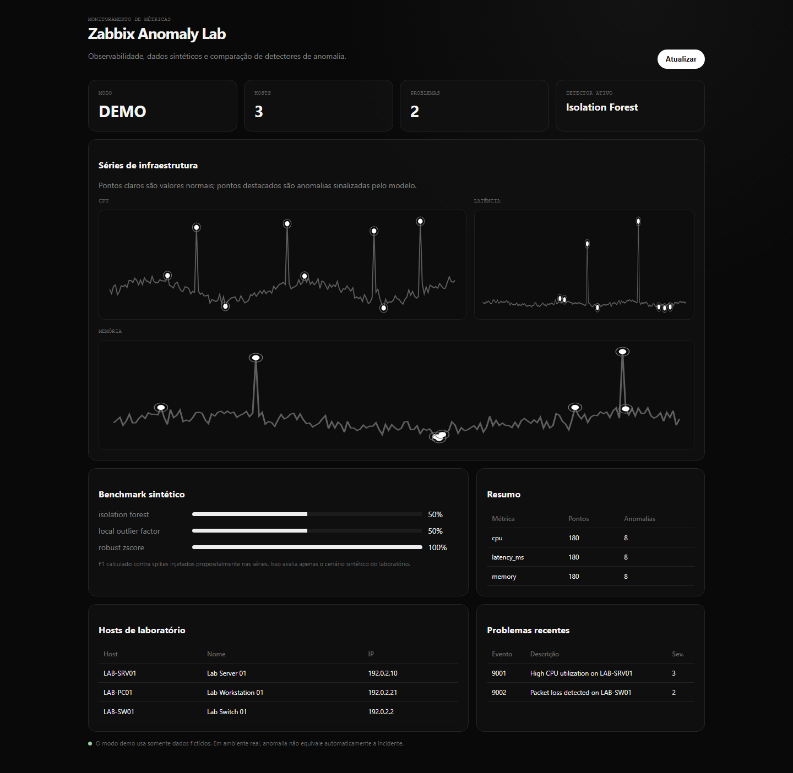

# Zabbix AIOps Lab

Laboratório de observabilidade e detecção de anomalias com integração JSON-RPC do Zabbix e avaliação de algoritmos em séries controladas.

## Visão geral

O projeto oferece dashboard FastAPI, relatório de hosts e problemas, séries métricas sintéticas e comparação entre detectores. O modo demo funciona sem credenciais externas; o modo live consulta uma instância Zabbix autorizada usando token de menor privilégio.

## Demonstração

A captura usa hosts e métricas sintéticos. O modo live não foi ativado nem conectado a uma infraestrutura corporativa.

## Funcionalidades

- Cliente JSON-RPC para a API do Zabbix.
- Relatório de hosts e problemas ativos.
- Modo demo com dados sintéticos e endereços reservados para documentação.
- Séries de CPU, memória e latência com anomalias injetadas.
- Isolation Forest, Local Outlier Factor e robust z-score.
- Benchmark com precision, recall e F1 contra anomalias conhecidas.
- Análise de séries enviadas por API.
- Validação de tamanho, valores finitos e faixa de contamination.
- Erros do serviço externo retornam mensagem sanitizada, sem repassar detalhes internos ao cliente.

## Stack

- Python 3.12+
- FastAPI e Pydantic
- scikit-learn e NumPy
- Requests e python-dotenv
- pytest e HTTPX

## Executar em modo demo

Windows PowerShell:

~~~powershell
python -m venv .venv
.venv\Scripts\Activate.ps1
pip install -r requirements.txt
$env:ZABBIX_DEMO = "true"
uvicorn web_app:app --reload
~~~

Abra http://127.0.0.1:8000.

## Configurar modo live

Configure as variáveis no ambiente do processo ou em um arquivo .env não versionado:

~~~dotenv
ZABBIX_DEMO=false
ZABBIX_URL=https://zabbix.example/api_jsonrpc.php
ZABBIX_TOKEN=seu-token-read-only
~~~

Use token read-only, TLS validado e apenas em infraestrutura sob sua autorização. Não salve o token no código, screenshots, issues ou commits.

## Testes

~~~bash
python -m pytest -q
python -m compileall -q .
~~~

A suíte valida relatórios demo, os três detectores, séries personalizadas, rejeição de valores não finitos e tratamento seguro de falhas do Zabbix.

## API principal

| Método | Rota | Objetivo |
|---|---|---|
| GET | /health | Estado da aplicação |
| GET | /report | Hosts e problemas do Zabbix |
| GET | /anomalies | Série demo e pontos sinalizados |
| GET | /benchmark | Comparação dos detectores |
| POST | /anomalies/analyze | Análise de uma série informada |

## Limitações

As séries de demonstração são sintéticas. Um detector de anomalia produz sinais, não confirma incidentes. A operação real deve considerar sazonalidade, manutenção, baseline por serviço, topologia, falsos positivos e validação com dados históricos autorizados.

Não envie métricas ou topologia corporativa para repositórios públicos. Use exemplos sintéticos em issues, relatórios e capturas de tela.
