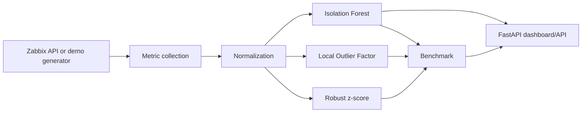

# Architecture

## Goal

This lab combines Zabbix API automation with anomaly detection over operational telemetry while keeping a safe demo mode as the default.

## Flow

## Safety model

Live Zabbix access is opt-in. Tokens should be read-only and scoped to the minimum required permissions. Demo mode must remain usable without corporate credentials.

## Production evolution

A production AIOps implementation would add durable metric storage, seasonality-aware baselines, maintenance windows, topology context, alert correlation, false-positive feedback and controlled remediation.
