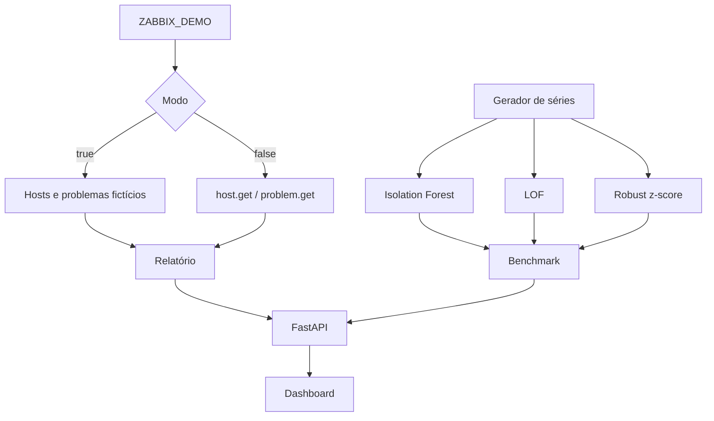

# Arquitetura

O dashboard pode ser usado sem Zabbix. A camada de relatório escolhe entre dados de demonstração e chamadas de leitura à API JSON-RPC; a camada de detecção trabalha com séries numéricas separadas dessa integração.

## Integração

O cliente envia JSON-RPC com o token no header `Authorization: Bearer`. No modo live, consulta somente hosts e problemas. O timeout é definido no cliente HTTP e redirecionamentos são desativados. A aplicação não envia comandos nem altera a configuração do servidor.

## Série sintética

Cada métrica possui 180 pontos gerados com uma função periódica e ruído aleatório controlado por semente fixa. Os índices dos picos inseridos ficam registrados em `anomaly.py`; o benchmark compara as marcações dos detectores com esses índices.

O Isolation Forest é o método usado na visualização principal. LOF e robust z-score estão disponíveis para comparação, não como um ensemble.

## O que o resultado não diz

O benchmark responde apenas se os algoritmos encontraram picos artificiais neste conjunto. Ele não mede falsos alarmes em produção, não prevê falhas e não aprende baseline por host. Para avançar, seria necessário trabalhar com histórico autorizado, segmentar por métrica/serviço e avaliar os alertas com contexto operacional.
