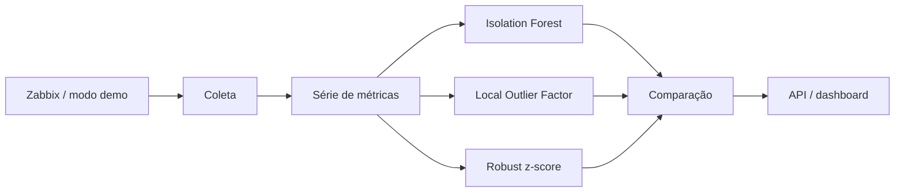

# Arquitetura

O laboratório funciona sem um servidor Zabbix real. O modo demo gera séries para testar a parte de análise; o modo live usa a API quando as variáveis de ambiente estão configuradas.

O Isolation Forest é o detector principal. Os outros métodos ficam no projeto para comparação e para facilitar testes com comportamentos diferentes.

No modo live, o ideal é usar um token somente leitura e com o menor acesso possível. O modo demo continua sendo o padrão para não depender de infraestrutura externa.
